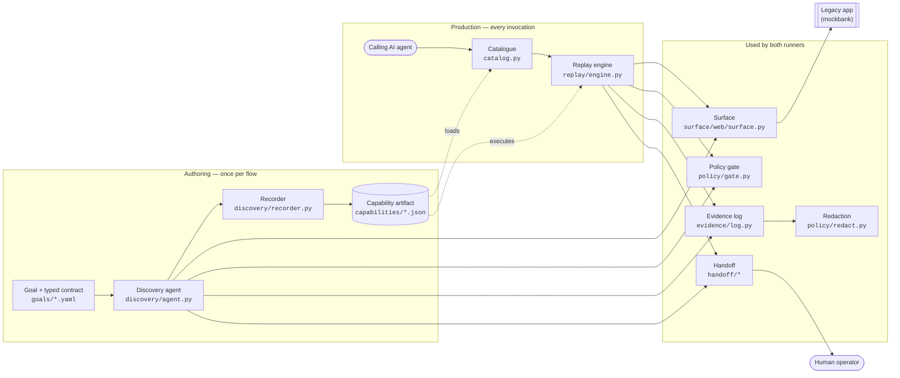
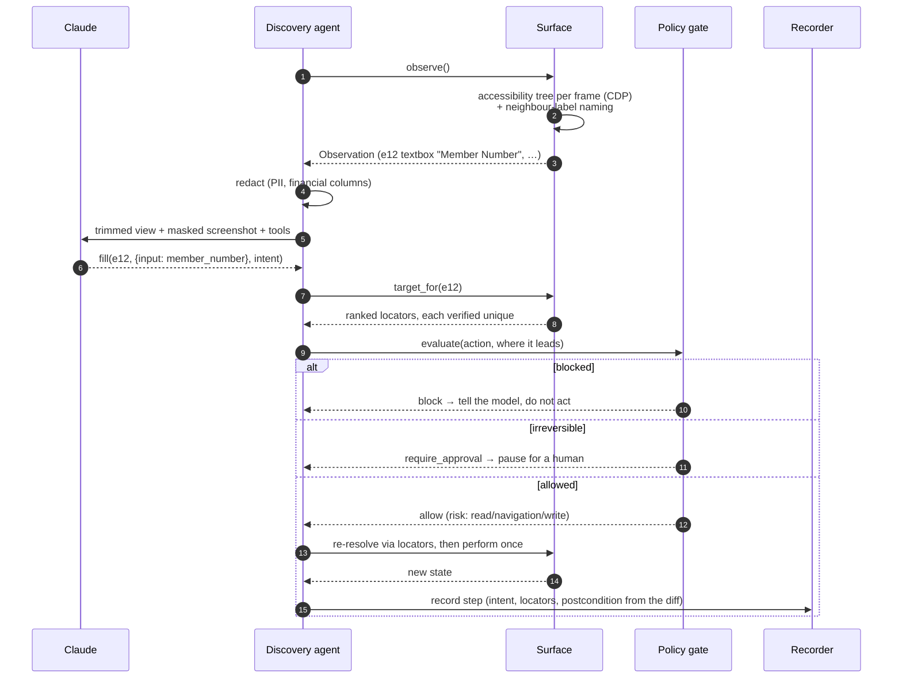
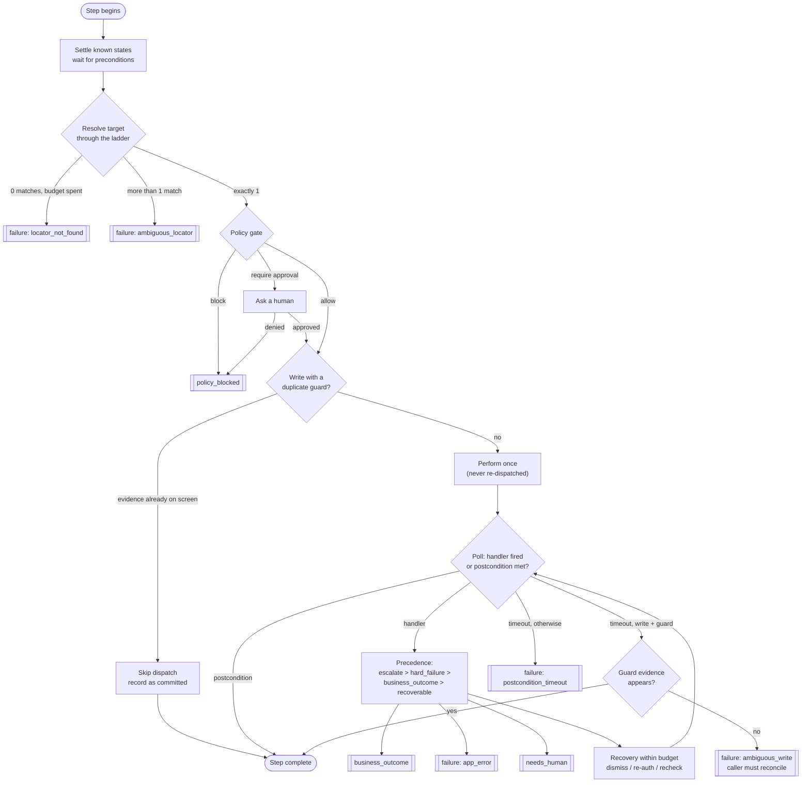
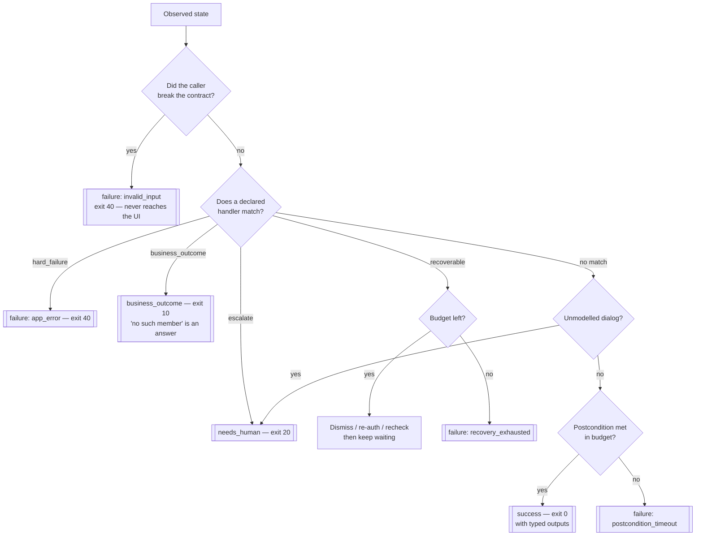
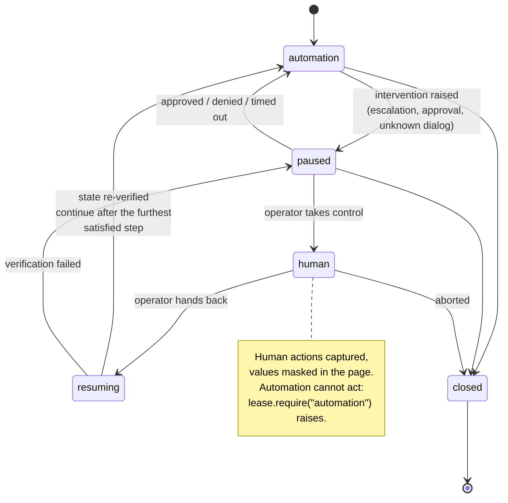
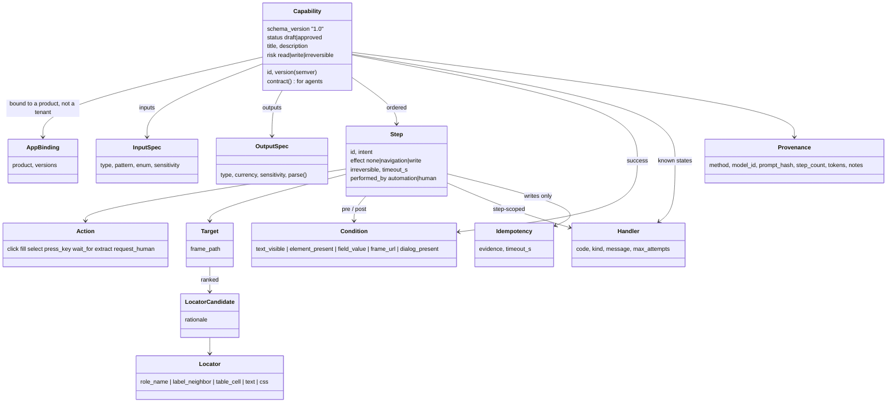
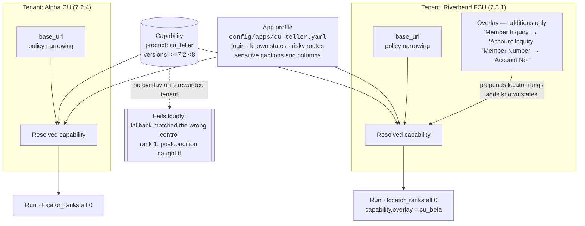
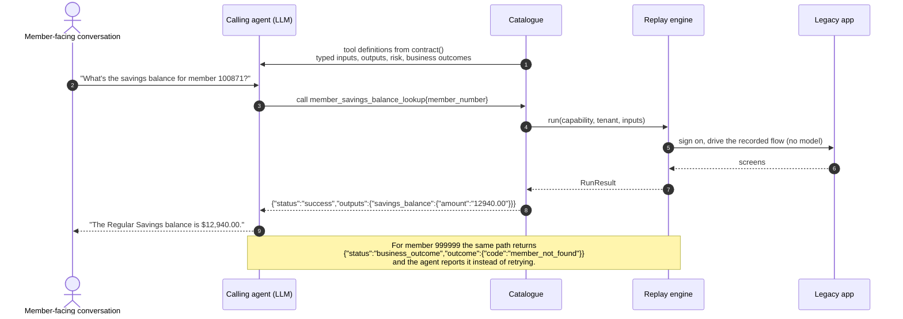

# Architecture diagrams

Eight views of the same system, from the outside in. Each one names the files it describes, so a
diagram and the code it claims to document can be checked against each other.

---

## 1. The whole system

Discovery is paid for once; replay is the production path; the catalogue is how an agent reaches it.
Policy, redaction and evidence are not a layer you pass through once — every runner uses them on
every action.

**The claim to defend:** the model appears in exactly one box. Nothing in `replay/` can import a
model client, and a test walks the import graph to prove it.

---

## 2. Discovery: one turn of observe → decide → act

The model never writes a selector. It points at an element id that is valid only for this
observation; the surface turns that into ranked locators, verified against the live page before the
action happens.

**Why re-resolve before acting** (step 10): an approval can take minutes, and a handle captured
before the pause may be stale. Re-resolving also proves at record time that the locators we are
about to store actually work.

---

## 3. Replay: the lifecycle of one step

The interesting part is the wait loop: known states are checked *before* the postcondition, so an
error screen is recognised rather than waited out.

---

## 4. Classifying what the screen is telling us

The brief calls conflating these the most common design mistake, so the taxonomy is data in the
artifact and the app profile, not branches in code.

Recovery is deliberately **not** a terminal status: it is reported alongside whichever status the run
reached, so "we dismissed a notice" can never be mistaken for an answer.

---

## 5. Who may act on the live session

One holder at a time, enforced in `Surface.perform` rather than merely recorded. Illegal transitions
raise; every transition is logged with the actor.

---

## 6. What a capability actually is

---

## 7. One capability, many institutions

An overlay may only **add** locator candidates and known states. It cannot change inputs, outputs,
step order, effects or risk, and tenant policy may only *narrow* the product policy — widening
raises `PolicyWideningError`.

---

## 8. How an AI agent calls a capability

---

## Where each diagram lives in code

| Diagram | Primary files |
|---|---|
| 1 Whole system | `src/cua/` top level |
| 2 Discovery turn | `discovery/agent.py`, `surface/web/surface.py`, `discovery/recorder.py` |
| 3 Step lifecycle | `replay/engine.py` (`_run_step`, `_await`, `_react`) |
| 4 Classification | `config/apps/cu_teller.yaml`, `schema/artifact.py` (`Handler`), `schema/results.py` |
| 5 Control | `handoff/control.py`, `handoff/capture.py`, `handoff/console.py` |
| 6 Artifact | `schema/artifact.py`, `schema/targets.py`, `schema/conditions.py` |
| 7 Multi-tenant | `tenancy/overlay.py`, `config/` |
| 8 Agent call | `catalog.py`, `cli.py` (`cua ask`) |
